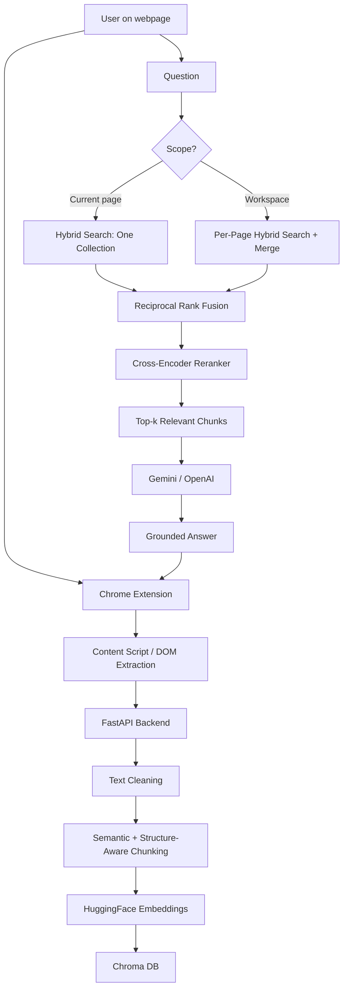
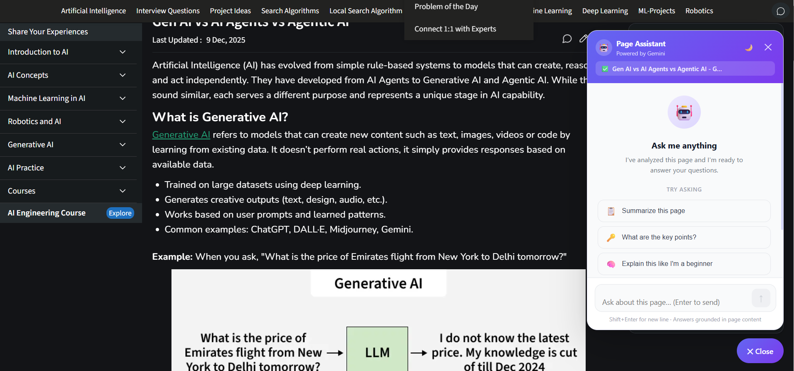
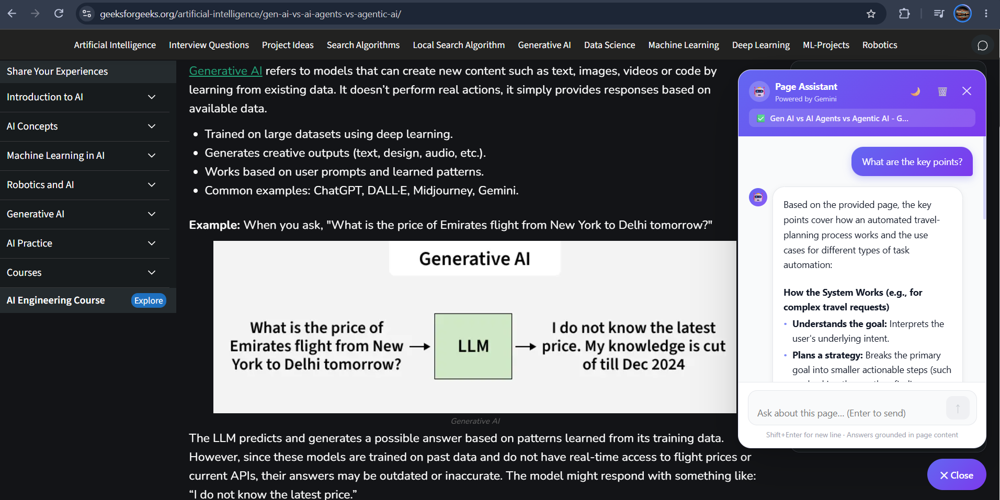
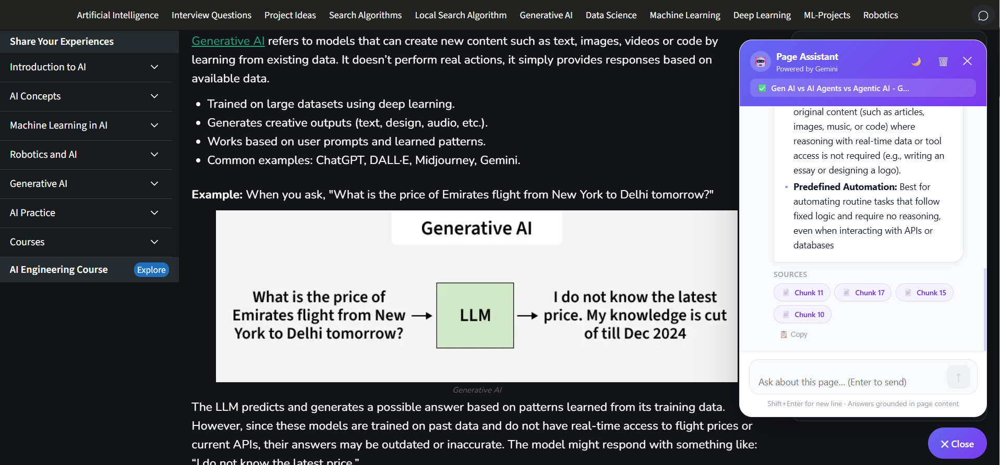
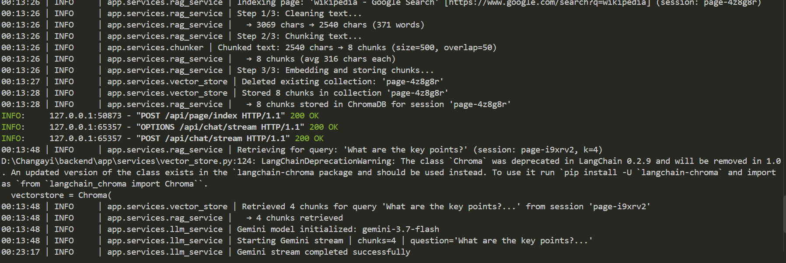

# 🤖 Changayi — Chrome Extension

[](https://react.dev/)
[](https://www.typescriptlang.org/)
[](https://developer.chrome.com/docs/extensions/mv3/)
[](https://fastapi.tiangolo.com/)
[](https://www.langchain.com/)
[](https://www.trychroma.com/)
[](https://ai.google.dev/)
[]()
[]()

> Your browser becomes a knowledge base: ask questions about the page you're reading — or across every tab you've saved — with answers grounded, reranked, and streamed in real time.

Changayi (Friend) is a Chrome extension + FastAPI RAG chatbot that turns browsing into research. Ask about the page you're reading, or build a **Multi-Tab Knowledge Base**: pin several tabs into a workspace and ask one question across all of them at once — hybrid retrieval (dense vectors + BM25) fused with Reciprocal Rank Fusion, then a **cross-encoder reranker** arbitrates candidates _from different tabs_, so the best chunk wins no matter which page it came from.

It analyzes **only on your command** — no page is read, indexed, or sent anywhere until you ask a question or explicitly add it to a knowledge base.

**Highlights**

|                                            |                                                                                                                          |
| ------------------------------------------ | ------------------------------------------------------------------------------------------------------------------------ |
| 🗂️ **Multi-Tab Knowledge Base**            | Group tabs into workspaces; one question searches all of them, with per-source attribution                               |
| 🔍 **Hybrid retrieval**                    | Dense semantic search + BM25 keywords, fused with Reciprocal Rank Fusion                                                 |
| 🎯 **Cross-encoder reranking**             | Jointly scores every (question, chunk) pair — a validated **+0.054 MRR@4** gain over the old pipeline at 100-query scale |
| 🧠 **Semantic + structure-aware chunking** | Heading hierarchies, breadcrumb context, and similarity-gated topic-coherent chunks                                      |
| 🔒 **On-demand, private by design**        | Nothing is indexed until you act; chunks stay in your local Chroma DB                                                    |
| ⚡ **Streaming answers**                   | Token-by-token SSE rendering with source cards showing the origin page                                                   |

Built with a FastAPI backend, LangChain, HuggingFace embeddings, and Chroma DB, Changayi demonstrates how a browser extension can transform passive browsing into an interactive, context-aware AI assistant.

---

## Contents

- [Why Changayi](#why-changayi)
- [Multi-Tab Knowledge Base](#multi-tab-knowledge-base)
- [Privacy & Indexing Policy](#privacy--indexing-policy)
- [What We Built](#what-we-built)
- [System Architecture](#system-architecture)
- [Actual Output](#actual-output)
- [Evaluation & Retrieval Performance](#evaluation--retrieval-performance)
- [Results and Impact](#results-and-impact)
- [Technical Challenges Faced](#technical-challenges-faced)
- [Getting Started](#getting-started)
- [Future Scope](#future-scope)

---

## Why Changayi

Most "chat with this page" tools fail in one of two ways: they **index everything you visit** (a privacy problem and wasted compute), or they only understand **one page at a time** (useless for real research that spans tabs). Changayi solves both:

- **Ask about the page you're reading.** Grounded answers, streamed, with the exact source chunks shown.
- **Ask across many pages.** Build a knowledge base from the tabs you care about — one question searches all of them, and you see which page each part of the answer came from.
- **Trust the answers.** A cross-encoder reranker and hybrid (dense + keyword) retrieval mean the context fed to the LLM is precisely relevant — validated with a 100-query benchmark showing gains on every quality metric over a standard dense-only RAG pipeline.

The subsections below cover the flagship feature, the privacy model, and then the full technical build.

---

## Multi-Tab Knowledge Base

Real research rarely lives on one page. The Multi-Tab Knowledge Base lets you group several indexed pages into a named **workspace** and ask questions that are answered across **all of them at once**.

### How it works

1. While browsing, click **＋ KB** in the chat panel. This analyzes the current page (on demand) and registers it into your workspace.
2. Repeat on other tabs — each page joins the same knowledge base.
3. Switch the scope selector from "Current page only" to your workspace. Every question is now answered from **all pages in the workspace combined**.

### Why this is where the retrieval stack shines

Cross-page retrieval is the scenario the upgraded pipeline was built for:

- **Per-page hybrid search fans out** to every page collection in the workspace, then results are merged and deduplicated.
- **Dense vector scores from different documents aren't directly comparable** — each document's chunks cluster around their own topic center. Only the cross-encoder reranker, which sees `(query, chunk)` pairs jointly, can fairly arbitrate candidates coming from different tabs.
- **BM25 catches exact tokens** (model numbers, error codes, names) that appear on only one of many tabs.
- Source cards show **which page** each answer chunk came from.

### Backend surface

| Endpoint                                     | Purpose                                                    |
| -------------------------------------------- | ---------------------------------------------------------- |
| `POST /api/workspace/create`                 | Create an empty workspace                                  |
| `GET /api/workspace/list`                    | List workspaces                                            |
| `GET /api/workspace/{id}`                    | Get one workspace with its pages                           |
| `POST /api/workspace/{id}/add_page`          | Register an indexed page (explicit opt-in)                 |
| `POST /api/workspace/{id}/remove_page?url=…` | Remove a page entry                                        |
| `DELETE /api/workspace/{id}`                 | Delete a workspace                                         |
| `POST /api/chat` / `POST /api/chat/stream`   | Both accept an optional `workspace_id` for cross-tab scope |

---

## Privacy & Indexing Policy

Changayi analyzes **only what you explicitly ask it to**:

- **No automatic indexing.** Opening a page does nothing — the floating button is active immediately, and no page text ever leaves the browser until you act.
- **Index on question.** Sending your first question triggers analysis of that page. Analysis state shows inside the panel, not as an ambient badge on every site.
- **Opt-in knowledge base.** A page enters a workspace only when you click **＋ KB**. Nothing is added to any KB automatically, and SPA navigation never silently re-indexes — the next action re-analyzes only if needed.
- **Local storage.** Chunks and embeddings stay in your local Chroma DB; workspace membership is a small local JSON registry. The only external call is to the LLM provider when generating an answer.

---

## What We Built

Changayi provides a browser-native AI assistant for webpage understanding. Instead of asking a general-purpose model to guess the content of a webpage, it extracts the visible text from the current page, indexes it locally, and uses vector search to retrieve only the most relevant chunks before generating a grounded answer.

---

### Core capabilities

- Chrome extension UI for instant webpage-based Q&A
- **On-demand indexing** — nothing is analyzed until you ask a question or explicitly add a page to a knowledge base
- **Multi-Tab Knowledge Base** — pin several tabs into a workspace and ask questions across all of them at once
- Page content extraction from the current browser tab
- Content cleaning and noise removal
- Structure-aware chunking (heading hierarchy + breadcrumb context prefixes)
- Semantic chunking (sentence-embedding similarity gating keeps chunks topically coherent)
- Hybrid retrieval: dense vector search + BM25 keyword search fused with Reciprocal Rank Fusion
- Cross-encoder reranking of retrieved candidates before answer generation
- Vector similarity search using Chroma DB
- LLM-powered answer generation using Gemini or OpenAI
- Streaming responses for a conversational experience
- Source-aware responses showing which page and chunk each answer came from

---

## System Architecture



---

### End-to-end flow

1. The user opens a webpage — **nothing is analyzed automatically**; the floating "Ask AI" button appears immediately.
2. When the user sends a question (or clicks "+ KB"), the page is analyzed on demand: a content script extracts the text and sends it to the backend.
3. The backend removes noise such as navigation, boilerplate, and irrelevant markup.
4. The cleaned text is split into semantically coherent, structure-aware chunks.
5. Each chunk is embedded and stored in Chroma DB.
6. Retrieval runs in **hybrid mode**: dense semantic search plus BM25 keyword search, fused with Reciprocal Rank Fusion. If a workspace is selected, this fans out across every page in the workspace.
7. A cross-encoder reranker scores each candidate against the question — including candidates from different tabs — and only the top chunks reach the LLM prompt.
8. The model answers using the retrieved content as context.
9. The response is streamed back to the extension UI and rendered in the panel with source cards showing the origin page.

---

### Key technology stack

| Layer             | Technology                                             |
| ----------------- | ------------------------------------------------------ |
| Frontend          | React, TypeScript, Vite                                |
| Browser extension | Chrome Manifest V3, Content Scripts                    |
| Backend           | Python, FastAPI                                        |
| RAG framework     | LangChain                                              |
| Embeddings        | HuggingFace sentence-transformers (`all-MiniLM-L6-v2`) |
| Keyword search    | BM25 (`rank_bm25`)                                     |
| Reranker          | Cross-encoder `ms-marco-MiniLM-L-6-v2`                 |
| Vector DB         | Chroma DB                                              |
| LLM provider      | Gemini / OpenAI                                        |
| Streaming         | Server-Sent Events (SSE)                               |

---

## Actual Output

### The chatbot on any webpage

The floating "Ask AI" panel opens on the page you're reading, ready for questions:



### Asking questions, getting grounded answers

The user asks a question about the page; Changayi answers strictly from that page's content, streaming the reply into the panel:





### Behind the scenes

The backend log for the same interaction — showing the RAG pipeline doing its work: cleaning and chunking the page, hybrid retrieval pulling dense + BM25 candidates, the cross-encoder reranking them, and Gemini generating the grounded answer:



---

### Technical Challenges Faced

1. Extracting useful content from webpages

Web pages often contain navigation bars, ads, scripts, repeated footer content, and layout noise that are irrelevant to user questions.

**Solution:**  
The project includes a cleaning layer that strips non-content sections before indexing. This ensures the vector database stores semantically meaningful text instead of noisy browser markup.

2. Handling SPA navigation

Modern web apps often change content without full page reloads, which makes naive page indexing unreliable.

**Solution:**  
The extension intercepts `pushState`, `replaceState`, and `popstate` to detect URL changes. Combined with the on-demand indexing policy, it marks the current session stale on navigation instead of silently re-indexing — the next user action re-analyzes the new page, and stale `session_id`s are auto-invalidated so answers can never come from the wrong page.

3. Keeping answers grounded in the page

A generic LLM may ignore the actual webpage or hallucinate an answer.

**Solution:**  
The RAG pipeline retrieves top-k relevant chunks from the current page and passes them to the LLM as context. This keeps the answer focused on the current page instead of general knowledge.

4. Maintaining UI responsiveness

Users expect the AI assistant to feel fast and conversational.

**Solution:**  
The project streams responses using SSE so the UI can progressively render the answer as tokens are generated, creating a smoother user experience.

5. Managing multiple sessions and pages

Different webpages often need separate contexts, and the same page may be revisited later.

**Solution:**  
The system uses a session-based approach tied to URL structure so each page has a stable context window without mixing unrelated content.

---

## Evaluation & Retrieval Performance

The retrieval pipeline is benchmarked with labeled evaluation harnesses. The initial 10-query benchmark (`scripts/eval_rag.py`) validated the rewrite; it was then **expanded to a 100-query benchmark** (`backend/scripts/eval_benchmark.py`) with realistic multi-section documents, distractor mass, and per-category analysis to validate the upgrade at scale. Metrics: Recall@4, MRR@4, nDCG@4, Precision@4, and retrieval latency.

---

### Pipeline comparison

| Stage          | Before                              | After                                                                                                                                           |
| -------------- | ----------------------------------- | ----------------------------------------------------------------------------------------------------------------------------------------------- |
| Chunking       | Fixed 500-char windows with overlap | **Semantic + structure-aware**: heading hierarchy detection, breadcrumb context prefixes, sentence-embedding similarity gating (threshold 0.55) |
| Retrieval      | Dense vector search only, top-4     | **Hybrid**: dense + BM25 keyword search, fused with Reciprocal Rank Fusion (`rrf_k=60`)                                                         |
| Post-retrieval | None                                | **Cross-encoder reranker** (`ms-marco-MiniLM-L-6-v2`) scoring (query, chunk) pairs jointly, 8 candidates → top-4                                |

---

### Initial benchmark (10 queries, 12 chunks) — validation

| Metric            | Before       | After                                 |
| ----------------- | ------------ | ------------------------------------- |
| Recall@4          | 0.900        | 0.900                                 |
| MRR@4             | 0.825        | 0.758                                 |
| nDCG@4            | 0.850        | 0.813                                 |
| Precision@4       | 0.225        | 0.225                                 |
| Retrieval latency | ~75 ms/query | ~1365 ms/query (CPU, incl. reranking) |

On a toy corpus, retrieval quality tied — as expected, since dense-only retrieval on ~12 chunks is nearly a solved problem.

---

### Expanded benchmark (100 queries, 51 chunks, 4 difficulty categories) — validation at scale

Dataset: 5 realistic multi-section documents + 2 distractor-only noise docs; queries split into _paraphrase_ (36), _keyword_ (43), _mixed_ (15), and _distractor_ (6) categories. Ablations isolate each stage's contribution:

| Config                                          | R@4       | MRR@4     | nDCG@4    | P@4       | ms/query |
| ----------------------------------------------- | --------- | --------- | --------- | --------- | -------- |
| OLD: char-splitter + dense-only                 | 0.940     | 0.873     | 0.925     | 0.235     | 68       |
| A1: new chunks + dense-only                     | 0.920     | 0.843     | 0.904     | 0.235     | 64       |
| A2: new chunks + hybrid (dense+BM25)            | **0.970** | 0.867     | 0.939     | **0.248** | 108      |
| A3: new chunks + hybrid + rerank (**FULL NEW**) | 0.960     | **0.927** | **0.951** | 0.245     | 491      |

---

### Interpretation

- **The full new pipeline beats the old one on every quality metric at scale**: Recall@4 +0.020, MRR@4 +0.054, nDCG@4 +0.026, Precision@4 +0.010.
- **Hybrid buys recall**: dense-only 0.920 → hybrid 0.970, including a **perfect 1.000 recall on distractor queries** — BM25+RRF recovers gold chunks that embeddings alone miss.
- **Reranking buys ranking quality**: on top of hybrid, MRR@4 jumps 0.867 → 0.927 and nDCG@4 0.939 → 0.951 — the cross-encoder pushes gold chunks to rank 1, which is what the LLM actually reads first.
- **Hybrid search closes the exact-token gap.** Dense embeddings blur acronyms, product names, and error codes; BM25 catches them, and RRF rewards chunks that rank high in _both_ rankings.
- **The reranker's decisiveness**: on the query "What is an LSTM?", the cross-encoder scored the gold chunk **+8.27** vs **−10.0 / −10.8** for irrelevant chunks — a ~19-point separation that bi-encoder cosine similarity (all candidates within ~0.02 of each other) cannot produce.
- **The latency cost is a known trade-off** (~68 → ~491 ms on CPU), dominated by cross-encoder forward passes. Tunable via `config.py`: `rerank_candidates` (8 → 4–5), skipping reranking for tiny collections (<30 chunks), or running the reranker on GPU/ONNX.

---

### Where the new pipeline wins

- Exact-token queries (acronyms, names, error codes) — BM25's territory
- Long, noisy, multi-section real pages with distractor mass
- Ranking-sensitive contexts where the gold chunk must rank first for the LLM

---

## Results and Impact

This project demonstrates a practical, benchmark-validated AI assistant built around the RAG pattern for browser-based knowledge work:

- **Measured retrieval quality**: a 100-query ablation benchmark shows the shipped pipeline beating a standard dense-only RAG baseline on Recall, MRR, nDCG, and Precision — with each stage (chunking, hybrid fusion, reranking) contributing measurably.
- **A differentiated product feature**: the Multi-Tab Knowledge Base moves the project beyond "chat with one page" into browser-based multi-document research — the scenario where hybrid retrieval + cross-encoder reranking is not just an upgrade but a necessity.
- **Privacy as a first-class design decision**: strict on-demand indexing means the assistant analyzes nothing until the user asks.
- **Transparent AI**: every answer ships with its source chunks and origin page, making the RAG process visible rather than a black box.

---

## Getting Started

### Prerequisites

- Python 3.10+
- Node.js 18+
- Google Chrome or a Chromium-based browser
- Gemini API key from Google AI Studio

### 1. Clone the repository

```bash
git clone https://github.com/solutionundertaken95/Changayi.git
cd Changayi
```

### 2. Set up the backend

```bash
cd backend
python -m venv venv
source venv/bin/activate
pip install -r requirements.txt
```

Copy the sample environment file:

```bash
cp ../.env.example .env
```

Update the `.env` file with your actual API keys.

### 3. Start the backend

```bash
uvicorn app.main:app --reload --port 8000
```

The backend should now be available at:

- API: `http://127.0.0.1:8000`
- Swagger UI: `http://127.0.0.1:8000/docs`

### 4. Set up the Chrome extension

```bash
cd extension
npm install
npm run build
```

Then load the unpacked extension in Chrome:

1. Open `chrome://extensions`
2. Enable Developer mode
3. Click Load unpacked
4. Select the `extension/dist` folder

The floating “Ask AI” button should then appear on supported web pages.

---

## Future Scope

- Persist vector collections across sessions for improved user continuity
- Support multi-page conversations with shared memory
- Add conversation history and follow-up question handling
- Support PDF and uploaded document indexing
- Improve retrieval quality using metadata filtering
- Persist the BM25 keyword index for site-scale (multi-page) hybrid retrieval
- Extend workspaces with shared/collaborative knowledge bases
- Add conversation memory inside workspaces (follow-up questions across tabs)
- Add user authentication and secure API access
- Add browser-side caching and offline support
- Add observability and usage analytics
- Extend from webpage Q&A to broader browser assistant workflows

---

## License

No explicit license is currently specified in the repository. If you plan to share or reuse this project publicly, adding an open-source license is recommended.
