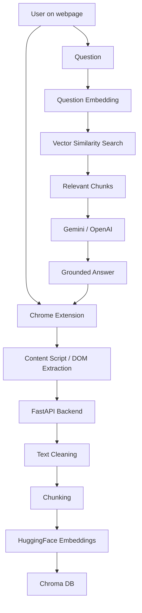

# 🤖 Changayi — Chrome Extension

[](https://react.dev/)
[](https://www.typescriptlang.org/)
[](https://developer.chrome.com/docs/extensions/mv3/)
[](https://fastapi.tiangolo.com/)
[](https://www.langchain.com/)
[](https://www.trychroma.com/)
[](https://ai.google.dev/)

> Ask questions about any webpage you're reading, powered by a full Retrieval-Augmented Generation (RAG) pipeline.

Changayi is a Chrome extension-based RAG chatbot that helps users ask questions about the webpage they are currently reading. It scrapes webpage content, cleans and chunks it, embeds the text, stores it in a vector database, and retrieves the most relevant context to answer questions using LLMs such as Gemini or OpenAI.

Built with a FastAPI backend, LangChain, HuggingFace embeddings, and Chroma DB, this project demonstrates how a browser extension can transform passive browsing into an interactive, context-aware AI assistant.

## Contents

- [What We Built](#what-we-built)
- [System Architecture](#system-architecture)
- [Technical Challenges and Solutions](#technical-challenges-and-solutions)
- [Results and Impact](#results-and-impact)
- [Getting Started](#getting-started)
- [Future Scope](#future-scope)

---

## What We Built

Changayi provides a browser-native AI assistant for webpage understanding. Instead of asking a general-purpose model to guess the content of a webpage, it extracts the visible text from the current page, indexes it locally, and uses vector search to retrieve only the most relevant chunks before generating a grounded answer.

### Core capabilities

- Chrome extension UI for instant webpage-based Q&A
- Page content extraction from the current browser tab
- Content cleaning and noise removal
- Text chunking and semantic embedding
- Vector similarity search using Chroma DB
- LLM-powered answer generation using Gemini or OpenAI
- Streaming responses for a conversational experience
- Source-aware responses based on the active page context

### Project composition

The repository is split into two primary parts:

- `backend/` — Python-based FastAPI service and RAG orchestration layer
- `extension/` — TypeScript-based Chrome extension UI and browser integration

From the project language composition:

- TypeScript: 57.8%
- Python: 41.5%
- CSS: 0.7%

This indicates a strong frontend/browser component alongside a significant Python backend and AI pipeline.

---

## System Architecture



### End-to-end flow

1. The user opens a webpage and clicks the floating AI button in the Chrome extension.
2. A content script extracts the page text and sends it to the backend.
3. The backend removes noise such as navigation, boilerplate, and irrelevant markup.
4. The cleaned text is split into chunks.
5. Each chunk is embedded and stored in Chroma DB.
6. When the user asks a question, the query is embedded and matched against the stored chunks.
7. The most relevant chunks are injected into the LLM prompt.
8. The model answers using the webpage content as context.
9. The response is streamed back to the extension UI and rendered in the panel.

### Key technology stack

| Layer | Technology |
|---|---|
| Frontend | React, TypeScript, Vite |
| Browser extension | Chrome Manifest V3, Content Scripts |
| Backend | Python, FastAPI |
| RAG framework | LangChain |
| Embeddings | HuggingFace sentence-transformers |
| Vector DB | Chroma DB |
| LLM provider | Gemini / OpenAI |
| Streaming | Server-Sent Events (SSE) |

---

## Technical Challenges and Solutions

### 1. Extracting useful content from webpages

Web pages often contain navigation bars, ads, scripts, repeated footer content, and layout noise that are irrelevant to user questions.

**Solution:**  
The project includes a cleaning layer that strips non-content sections before indexing. This ensures the vector database stores semantically meaningful text instead of noisy browser markup.

### 2. Handling SPA navigation

Modern web apps often change content without full page reloads, which makes naive page indexing unreliable.

**Solution:**  
The extension monitors navigation events and re-indexes content when the page changes. This helps maintain accurate context for single-page applications.

### 3. Keeping answers grounded in the page

A generic LLM may ignore the actual webpage or hallucinate an answer.

**Solution:**  
The RAG pipeline retrieves top-k relevant chunks from the current page and passes them to the LLM as context. This keeps the answer focused on the current page instead of general knowledge.

### 4. Maintaining UI responsiveness

Users expect the AI assistant to feel fast and conversational.

**Solution:**  
The project streams responses using SSE so the UI can progressively render the answer as tokens are generated, creating a smoother user experience.

### 5. Managing multiple sessions and pages

Different webpages often need separate contexts, and the same page may be revisited later.

**Solution:**  
The system uses a session-based approach tied to URL structure so each page has a stable context window without mixing unrelated content.

---

## Results and Impact

This project demonstrates a practical and visually interactive AI assistant built around the RAG pattern for browser-based knowledge work.

### Verified project facts

- 2 main modules: `backend` and `extension`
- 1 browser-based Q&A product built as a Chrome extension
- 1 FastAPI service handling indexing, retrieval, and LLM interaction
- 1 vector database layer using Chroma DB
- 1 semantic embedding flow using HuggingFace models
- 1 streaming chat experience for interactive responses

### Measured / practical impact

Although the repository does not publish benchmark numbers or benchmark datasets, the implementation is designed to provide:

- page-aware answers rather than generic AI responses
- lower hallucination risk by grounding the LLM in retrieved page content
- instant exploration of webpage content without leaving the browser
- a strong portfolio demonstration of GenAI + browser extension engineering

This is best viewed as a full-featured prototype for a browser-based assistant rather than a production-scale enterprise application.

---

## Getting Started

### Prerequisites

- Python 3.10+
- Node.js 18+
- Google Chrome or a Chromium-based browser
- Gemini API key from Google AI Studio

### 1. Clone the repository

```bash
git clone https://github.com/solutionundertaken95/Changayi.git
cd Changayi
```

### 2. Set up the backend

```bash
cd backend
python -m venv venv
source venv/bin/activate
pip install -r requirements.txt
```

Copy the sample environment file:

```bash
cp ../.env.example .env
```

Update the `.env` file with your actual API keys.

### 3. Start the backend

```bash
uvicorn app.main:app --reload --port 8000
```

The backend should now be available at:

- API: `http://127.0.0.1:8000`
- Swagger UI: `http://127.0.0.1:8000/docs`

### 4. Set up the Chrome extension

```bash
cd extension
npm install
npm run build
```

Then load the unpacked extension in Chrome:

1. Open `chrome://extensions`
2. Enable Developer mode
3. Click Load unpacked
4. Select the `extension/dist` folder

The floating “Ask AI” button should then appear on supported web pages.

---

## Future Scope

- Add support for OpenAI and other model providers in a unified abstraction layer
- Persist vector collections across sessions for improved user continuity
- Support multi-page conversations with shared memory
- Add conversation history and follow-up question handling
- Support PDF and uploaded document indexing
- Improve retrieval quality using metadata filtering and better chunk strategies
- Add user authentication and secure API access
- Add browser-side caching and offline support
- Add observability and usage analytics
- Extend from webpage Q&A to broader browser assistant workflows

---

## License

No explicit license is currently specified in the repository. If you plan to share or reuse this project publicly, adding an open-source license is recommended.

---

Built with React + TypeScript + FastAPI + LangChain + HuggingFace + Chroma DB + Gemini.
